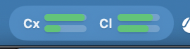
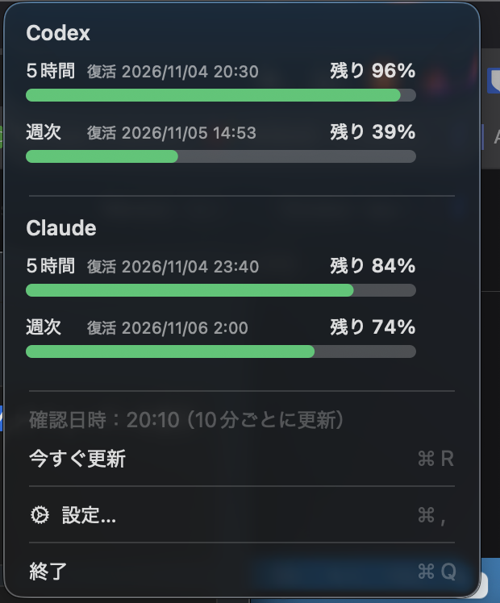
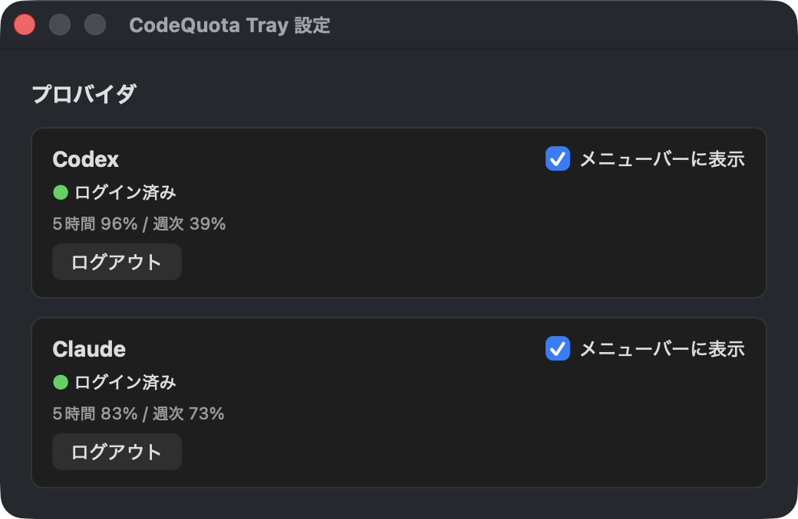

# CodeQuota Tray — Codex / Claude Code 残量モニター

macOS の**メニューバー**、Windows の**通知領域**に、Codex と Claude Code のプラン残量を緑のゲージで表示する小さなアプリです。

- **5時間枠と週次枠の2本バー**（上＝5時間、下＝週次）。残り20%以下は赤。
- クリックすると、残り%と復活時刻を確認できます。10分ごとに自動更新。
- ブラウザでログインするだけ。CLI のインストールは不要です。
- メニューの「設定…」で、プロバイダごとのログイン状態の確認、ログアウト、表示の ON/OFF ができます。

## インストール

- **macOS（13以降）**: `.dmg` を開き、「CodeQuota Tray」を「Applications」へドラッグ。初回は右クリック → 開く。
- **Windows（10/11）**: `.msi` を実行（管理者権限が必要）。

署名・公証をしていないため、初回に警告が出る場合があります。

## 表示する数値

| メニューバー | メニュー | 設定 |
| :---: | :---: | :---: |
|  |  |  |

- **残量 = 100 − 使用率**。個人のサブスクリプションの使用枠であり、API の課金残高ではありません。
- API キー / Bedrock / Vertex など、OAuth プラン以外では取得できません。

## 注意

- 使用量 API は公開・安定保証されたものではなく、仕様変更で表示できなくなる可能性があります。
- ログインには各公式 CLI の OAuth クライアントを利用しています。各社の規約・仕様変更で、サードパーティアプリからのログインが制限される可能性があります。自己責任でご利用ください。
- Codex のログインは `localhost:1455` を使うため、Codex CLI のログイン操作中は先にそちらを終了してください。
- Windows 版は未ビルドです。

ライセンス: MIT（[LICENSE](LICENSE)）
